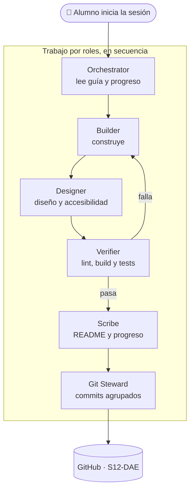
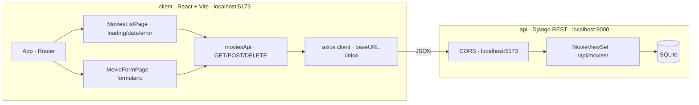

# S12-DAE — Laboratorio 12: Servicios Web

Integrar una consola React con una API Django REST usando Axios y CORS.
Se evalúan listar, crear, eliminar y resolver carga, datos y error.
Rama de trabajo: `main`.

## Flujo de trabajo



```text
PLAN → BUILD → DESIGN → VERIFY → NOTES → COMMIT LOCAL → PUSH ÚNICO
  ↑                       │                         │
  └────────── si falla ───┘             estado breve al alumno
```

## Arquitectura objetivo



## Árbol real esperado

```text
S12-DAE/
├── AGENTS.md · README.md · docs/PROGRESS.md
├── api/ (Django)
│   ├── manage.py · requirements.txt · .env.example
│   ├── config/ (settings, urls)
│   └── movies/ (Movie, serializer, viewset, tests, fixture)
└── client/ (React + Vite)
    ├── .env.example
    └── src/
        ├── api/ (client.js · moviesApi.js)
        ├── pages/ (MoviesListPage · MovieFormPage)
        ├── components/ (Header · Button · Skeleton · ErrorState · ConfirmDialog)
        └── styles/
```

## Comandos y reglas

API en `api/`: activar `.venv`, `python manage.py migrate`, `python manage.py loaddata movies`, `python manage.py test`, `python manage.py runserver`.
Cliente en `client/`: `npm install`, `npm run dev`, `npm run lint`, `npm run build`, `npm test`.
Python PEP 8; settings y secretos se leen de `.env`, nunca se sube `.env`; CORS autoriza solo `http://localhost:5173`. CSS oscuro de Aurora; React usa componentes por carpeta. Los cambios se agrupan en commits locales y se suben en un push al cierre.

## Terminado

La API ofrece CRUD con CORS estricto, y el cliente usa Axios para listar, crear y eliminar con estados de carga/datos/error. README, tests y progreso están actualizados.
